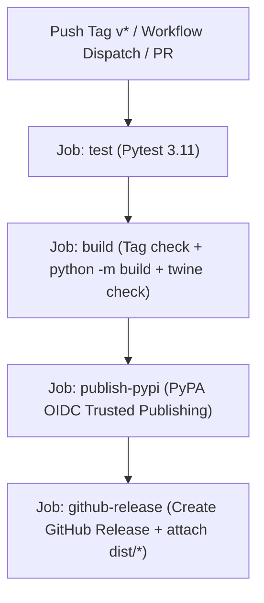

# Implementation Plan: Automate PyPI & GitHub Release via GitHub Actions

This plan automates the build, verification, and publishing of `gitpr-cli` to PyPI and GitHub Releases whenever a version tag (`v*`) is pushed, replacing the manual `build` + `twine upload` process.

## User Review Required

> [!IMPORTANT]
> **PyPI Trusted Publishing Configuration**:
> The workflow uses PyPA's official OpenID Connect (OIDC) Trusted Publishing (`pypa/gh-action-pypi-publish@release/v1`).
> In your PyPI project settings (`https://pypi.org/manage/project/gitpr-cli/settings/publishing/`):
> 1. Add a new GitHub publisher for repository owner and project (e.g. `natanfiuza/gitpr` or `gitpr-cli/gitpr`).
> 2. Set Workflow name to `release.yml`.
> 3. Set Environment name to `pypi`.
> 4. In GitHub repository settings (Settings -> Environments), ensure an environment named `pypi` exists (or create it).

## Proposed Changes

### GitHub Actions Workflows

#### [NEW] `.github/workflows/release.yml`

Create the release workflow with 4 structured jobs:
1. **`test`**: Clones repository, installs dependencies, sets up the GitPR profile (`mkdir -p ~/.gitpr && touch ~/.gitpr/.env`), and runs `pytest tests/ -q`.
2. **`build`**: Depends on `test`.
   - Runs a Python assertion asserting `v${__version__} == ${GITHUB_REF_NAME}` when triggered by a tag.
   - Installs `build` and `twine`.
   - Runs `python -m build` to generate `dist/*.whl` and `dist/*.tar.gz`.
   - Runs `twine check --strict dist/*` to validate package metadata.
   - Uploads distribution packages as an artifact.
3. **`publish-pypi`**: Depends on `build` (runs only for `v*` tags).
   - Requests OIDC token (`permissions: id-token: write`).
   - Uses `pypa/gh-action-pypi-publish@release/v1` targeting the `pypi` environment.
4. **`github-release`**: Depends on `publish-pypi` (runs only for `v*` tags).
   - Uses `softprops/action-gh-release@v2` with `permissions: contents: write`.
   - Attaches `dist/*` files and enables `generate_release_notes: true`.



---

### Documentation & Reports

#### [MODIFY] `docs/reports/relatorio_estado_v0.0.21.md`
Update the pending backlog item in the status report from "Item herdado, ainda aberto" to resolved/closed.

#### [MODIFY] `GEMINI.md`
Update the commands section and documentation regarding CI/CD to document the automated tag-based release flow alongside the existing workflows.

---

## Verification Plan

### Automated Validation
1. **Local build test**:
   Verify that `python -m build` and `twine check` pass locally against the current repository state:
   ```bash
   pip install build twine
   python -m build
   twine check --strict dist/*
   ```
2. **Workflow syntax check**:
   Validate YAML structure, indentation, and Action versions against GitHub Actions schema.
3. **Version check guard simulation**:
   Execute the version comparison script locally to ensure it properly validates `v1.4.4` matching `src.updater.__version__` and fails on mismatch.
