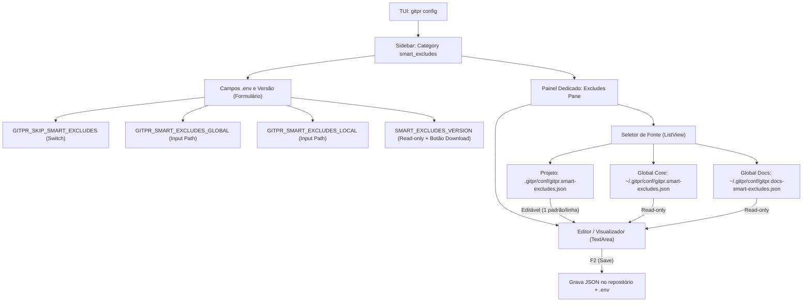

# Implementation Plan — Seção Smart Exclude na TUI (`gitpr config`)

## Goal Description
Implementar a seção dedicada **Smart Excludes** na TUI de configuração (`gitpr config`), encerrando o **Item 10** herdado do survey original da tela de configuração. 

Atualmente, os campos `GITPR_SMART_EXCLUDES_*` estão alocados sob a categoria temporária `diff`, o marcador `SMART_EXCLUDES_VERSION` está isolado em `advanced`, e a interface não oferece visualização nem edição das regras de exclusão de diff do projeto. 

Esta mudança substitui a categoria `diff` por `smart_excludes`, agrupa todos os campos pertinentes, e introduz um painel dedicado para inspecionar as listas globais (Core e Docs) e criar/editar as regras locais do repositório (`.gitpr/conf/gitpr.smart-excludes.json`) com ciclo de vida unificado (`F2`, `Ctrl+R`, `Esc`).

---

## User Review Required
> [!IMPORTANT]
> **Substituição da Categoria `diff` por `smart_excludes`:**
> A categoria `diff` deixará de existir no menu lateral, sendo substituída por `smart_excludes` (label: *Smart Excludes*, doc: `smart-excludes.md`). Como 100% dos campos de `diff` eram variáveis de smart exclude, essa mudança consolida a configuração de filtros em uma única seção especializada.

> [!NOTE]
> **Formato do Editor do Projeto:**
> A edição de `.gitpr/conf/gitpr.smart-excludes.json` é feita via `TextArea` com **um padrão glob por linha** (ex: `*.pyc`, `dist/`), ignorando linhas em branco e comentários iniciados por `#`. Ao salvar, o arquivo JSON é gerado automaticamente com indentação limpa e comentário explicativo preservado.

---

## Proposed Changes



---

### Componente 1: Glossário e Domínio
#### [MODIFY] `CONTEXT.md`
- Adicionado termo canônico `Smart Excludes` definindo o motor de filtros baseado em pathspec nativo do Git e suas três camadas (Core, Docs, Projeto). *(Já efetuado no passo de domain-modeling)*.

---

### Componente 2: Schema de Configuração
#### [MODIFY] `src/config_schema.py`
- Substituir a categoria `"diff"` por `"smart_excludes"` em `CATEGORIES`:
  ```python
  Category(
      "smart_excludes",
      __("Smart Excludes"),
      __("Paths excluded from every diff sent to the AI, and project exclusion rules."),
      doc="smart-excludes.md",
  ),
  ```
- Atualizar a categoria dos campos `GITPR_SKIP_SMART_EXCLUDES`, `GITPR_SMART_EXCLUDES_GLOBAL` e `GITPR_SMART_EXCLUDES_LOCAL` de `"diff"` para `"smart_excludes"`.
- Mover `SMART_EXCLUDES_VERSION` da categoria `"advanced"` para `"smart_excludes"`, mantendo seu botão `ACTION_DOWNLOAD` ("Filters List Version").

---

### Componente 3: Utilitários de Exclusões
#### [MODIFY] `src/core.py`
- Expor funções auxiliares limpas para leitura e gravação dos padrões de exclusão em formato lista de linhas:
  - `load_raw_project_excludes_text(project_root=None) -> tuple[bool, str]`: retorna se o arquivo existe e o texto formatado (um padrão por linha).
  - `save_project_excludes_text(text: str, project_root=None) -> None`: converte linhas para lista `excludes` e salva `.gitpr/conf/gitpr.smart-excludes.json`.
  - `load_global_core_excludes_text() -> str`: carrega os padrões globais core formatados em linhas.
  - `load_global_docs_excludes_text() -> str`: carrega os padrões globais docs formatados em linhas.

---

### Componente 4: TUI (`src/ui/config_app.py`)
#### [MODIFY] `src/ui/config_app.py`
- Adicionar constantes e IDs para o painel de smart exclude:
  - `_EXCLUDES_PANE_ID = "excludes_pane"`
  - `_EXCLUDES_LIST_ID = "excludes_list"`
  - `_EXCLUDES_EDITOR_ID = "excludes_editor"`
  - `_EXCLUDES_CREATE_ID = "excludes_create"`
  - `_EXCLUDES_STATUS_ID = "excludes_status"`
  - `_EXCLUDES_ACTIONS_ID = "excludes_actions"`
  - `_EXCLUDES_NOTE_ID = "excludes_note"`
- Incluir regras CSS para layout do painel (altura, bordas, botões compactos).
- No método `compose()`:
  - Montar o painel `#excludes_pane` contendo a lista com as 3 fontes (Projeto, Core, Docs), a nota explicativa/status, o botão `[+ Criar arquivo do projeto]` (quando ausente) e a área `TextArea` para visualização/edição.
- No método `_render_view()`:
  - Exibir `#excludes_pane` quando `self.selected_category() == "smart_excludes"` e não houver termo de busca ativo.
- No ciclo de vida:
  - Carregar estado inicial das 3 fontes no `on_mount()`.
  - Rastrear alterações com `self.dirty_excludes()`.
  - Integrar no `_collect_plan()` para salvar com `F2`.
  - Suportar reversão com `Ctrl+R` quando o editor estiver focado.
  - Abrir confirmação de descarte no `action_escape()` se houver alterações não salvas.
  - Adicionar handler para o botão de criação do arquivo local (`_on_create_project_excludes`).

---

### Componente 5: Internacionalização (i18n)
#### [MODIFY] `langs/pt_br.json`, `langs/pt_pt.json`, `langs/es_es.json`, `langs/fr_fr.json`
- Adicionar as traduções de todas as novas chaves literais `__("...")` introduzidas no schema e na interface, assegurando que o gate estrito de `tests/test_i18n.py` passe com 100% de paridade.

---

### Componente 6: Documentação Técnica
#### [MODIFY] `docs/smart-excludes.md` e traduções (`.pt_br.md`, `.pt_pt.md`, `.es_es.md`, `.fr_fr.md`)
- Documentar a seção interativa de Smart Excludes na TUI (`gitpr config`).
- Explicar como inspecionar as listas Core e Docs e como editar e salvar regras locais diretamente pelo terminal.

---

## Verification Plan

### Automated Tests
1. **Schema & Categorias**:
   ```bash
   pytest tests/test_config_schema.py -v
   ```
   - Confirmação de que `smart_excludes` substitui `diff` em `CATEGORIES`.
   - Confirmação de que os campos `GITPR_SMART_EXCLUDES_*` e `SMART_EXCLUDES_VERSION` pertencem à categoria `smart_excludes`.
2. **Ciclo de Vida e TUI**:
   ```bash
   pytest tests/test_config_app.py -v
   ```
   - Teste de renderização da categoria `smart_excludes`.
   - Teste de visibilidade do painel `#excludes_pane`.
   - Teste de alternância entre as 3 fontes (Projeto, Core, Docs).
   - Teste de criação do arquivo local via botão.
   - Teste de dirty-state, salvamento atômico com `F2` e reversão com `Ctrl+R`.
3. **Internacionalização (i18n)**:
   ```bash
   pytest tests/test_i18n.py -v
   ```
   - Verificação de zero chaves faltantes ou órfãs nos 5 arquivos de idioma.
4. **Suíte Geral de Regressão**:
   ```bash
   pytest tests/test_config_*.py -q
   ```

### Manual Verification
1. Abrir a TUI de configuração:
   ```bash
   python run.py config
   ```
2. Navegar pelo menu lateral até a opção **Smart Excludes**.
3. Conferir:
   - Exibição dos switches e campos de caminho (`GITPR_SKIP_SMART_EXCLUDES`, paths global e local).
   - Presença do campo `SMART_EXCLUDES_VERSION` com botão de forçar download.
   - Painel inferior com as 3 opções: Projeto, Global Core, Global Docs.
   - Selecionar Global Core: visualização somente leitura dos padrões de lockfiles/minified.
   - Selecionar Global Docs: visualização somente leitura das extensões de documentação.
   - Selecionar Projeto: se ausente, exibição do botão para criar; se presente, editor habilitado.
   - Digitar novos padrões (ex: `test-output/`), pressionar `F2` e verificar a gravação em `.gitpr/conf/gitpr.smart-excludes.json`.
