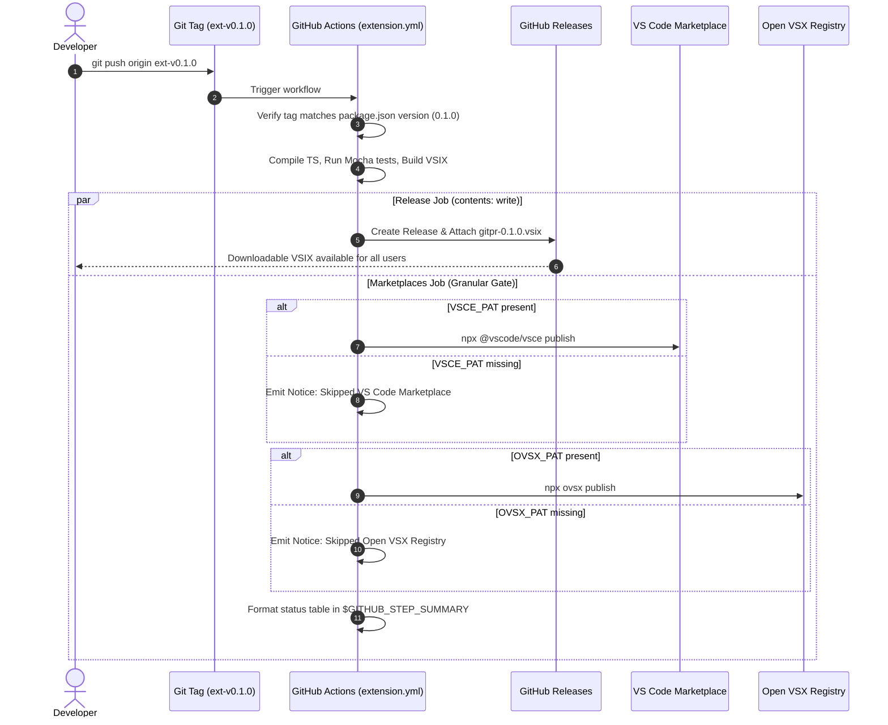

# Walkthrough — Publish GitPR Extension (VSIX Distribution & Granular Marketplaces)

This walkthrough documents the decoupling of the GitPR VS Code & Cursor extension distribution pipeline, establishing permanent official `.vsix` releases on GitHub and resilient marketplace publication.

---

## 1. Key Accomplishments

1. **Decoupled GitHub Release Job for Extension VSIX**:
   - Refactored `.github/workflows/extension.yml` so that triggering an extension release tag (`ext-v*`) automatically creates an official GitHub Release with `gitpr-0.1.0.vsix` permanently attached.
   - Users and contributors can download and install the extension directly with zero dependencies on third-party marketplace accounts.

2. **Resilient Granular Marketplace Gate**:
   - Replaced the previous blocking `missing=1; exit 1` check with independent evaluation of `VSCE_PAT` and `OVSX_PAT`.
   - If a secret is present, the respective marketplace publication runs automatically.
   - If a secret is absent, the workflow logs a GitHub Actions `::notice::` and outputs an organized Markdown status table to `$GITHUB_STEP_SUMMARY`, allowing the GitHub Release to succeed.

3. **Domain Model Alignment**:
   - Updated `CONTEXT.md` to retire the deprecated `Fail-fast secret check` term in favor of the canonical `Granular marketplace gate`.

4. **Multi-Language Installation Documentation**:
   - Updated all 5 language versions of `docs/editor-extension*.md` (`EN`, `PT-BR`, `PT-PT`, `ES-ES`, `FR-FR`) with 1-click terminal install commands (`code --install-extension gitpr-0.1.0.vsix` and `cursor --install-extension gitpr-0.1.0.vsix`) and GUI instructions.
   - Updated `README.md` to link directly to the VSIX release download.
   - Updated `docs/marketplace-publishing-guide.md` reflecting progressive marketplace deployment.

---

## 2. Verification Results

### Automated Tests
- **Python MCP Server Test Suite**:
  ```bash
  pytest tests/test_mcp_server.py -q
  # Output: 117 passed in 13.52s
  ```
- **Extension TypeScript Build, Mocha Tests & VSIX Packaging**:
  ```bash
  cd extensions/vscode; npm run compile; npm test; npm run package
  # Output:
  # 7 passing (8s) - including live stdio handshake with Python MCP server
  # DONE Packaged: gitpr-0.1.0.vsix (34 files, 90.34 KB)
  ```

---

## 3. Workflow Diagram


