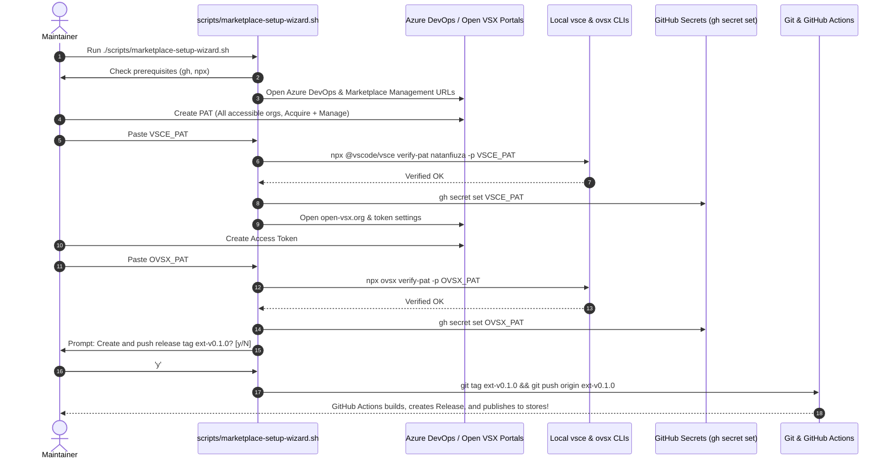

# Walkthrough — Marketplace Setup Wizard & Extension Publishing

We have implemented an interactive, delightful, and automated setup wizard ([`scripts/marketplace-setup-wizard.sh`](file:///c:/Users/nataniel/projetos/pessoal/gitpr_projeto/gitpr/scripts/marketplace-setup-wizard.sh)) to streamline the onboarding, local validation, and GitHub repository secret provisioning for publishing the GitPR Editor Extension to both the Visual Studio Marketplace (VS Code) and the Open VSX Registry (Cursor).

---

## Architecture & Flow



---

## Changes Implemented

1. **Interactive Setup Wizard**:
   - Created [`scripts/marketplace-setup-wizard.sh`](file:///c:/Users/nataniel/projetos/pessoal/gitpr_projeto/gitpr/scripts/marketplace-setup-wizard.sh) with 5 structured stages (`TOTAL_STAGES=5`).
   - Cross-platform browser opening (`wslview`, `explorer.exe`, `xdg-open`, `open`).
   - Non-echoing masked password input (`ask_secret`).
   - Local validation via `npx --yes @vscode/vsce verify-pat` and `npx --yes ovsx verify-pat`.
   - Direct provisioning to GitHub repository secrets (`gh secret set`), never saving plaintext credentials on disk.
   - Release prompt to optionally create and push the `ext-v0.1.0` tag.

2. **Domain Modeling**:
   - Added `Marketplace setup wizard` to [`CONTEXT.md`](file:///c:/Users/nataniel/projetos/pessoal/gitpr_projeto/gitpr/CONTEXT.md).

3. **Multi-language Documentation Parity (5 languages)**:
   - Added Quick Setup section to:
     - [`docs/marketplace-publishing-guide.md`](file:///c:/Users/nataniel/projetos/pessoal/gitpr_projeto/gitpr/docs/marketplace-publishing-guide.md) (English)
     - [`docs/marketplace-publishing-guide.pt_br.md`](file:///c:/Users/nataniel/projetos/pessoal/gitpr_projeto/gitpr/docs/marketplace-publishing-guide.pt_br.md) (Português do Brasil)
     - [`docs/marketplace-publishing-guide.pt_pt.md`](file:///c:/Users/nataniel/projetos/pessoal/gitpr_projeto/gitpr/docs/marketplace-publishing-guide.pt_pt.md) (Português de Portugal)
     - [`docs/marketplace-publishing-guide.es_es.md`](file:///c:/Users/nataniel/projetos/pessoal/gitpr_projeto/gitpr/docs/marketplace-publishing-guide.es_es.md) (Español)
     - [`docs/marketplace-publishing-guide.fr_fr.md`](file:///c:/Users/nataniel/projetos/pessoal/gitpr_projeto/gitpr/docs/marketplace-publishing-guide.fr_fr.md) (Français)
   - Updated [`README.md`](file:///c:/Users/nataniel/projetos/pessoal/gitpr_projeto/gitpr/README.md) to reference the wizard.

4. **Automated Verification**:
   - Created [`tests/unit/test_marketplace_wizard_syntax.py`](file:///c:/Users/nataniel/projetos/pessoal/gitpr_projeto/gitpr/tests/unit/test_marketplace_wizard_syntax.py).
   - Updated [`tests/unit/test_marketplace_publishing_guide_docs_parity.py`](file:///c:/Users/nataniel/projetos/pessoal/gitpr_projeto/gitpr/tests/unit/test_marketplace_publishing_guide_docs_parity.py).

---

## Verification Results

### 1. Python Unit Tests & Parity
```
pytest tests/unit/test_marketplace_wizard_syntax.py tests/unit/test_marketplace_publishing_guide_docs_parity.py -v
============================== 7 passed in 6.36s ==============================
```
- `test_marketplace_wizard_file_exists_and_executable_shebang`: PASSED
- `test_marketplace_wizard_required_markers_and_stages`: PASSED
- `test_marketplace_wizard_bash_syntax_validation`: PASSED (`bash -n` confirmed 100% clean syntax)
- `test_marketplace_publishing_guide_all_files_exist_and_non_empty`: PASSED
- `test_marketplace_publishing_guide_section_parity`: PASSED
- `test_marketplace_publishing_guide_token_preservation`: PASSED
- `test_editor_extension_cross_links_to_localized_guides`: PASSED

### 2. Extension Mocha Test Suite (including Live MCP stdio)
```
npm test (in extensions/vscode)
  GitPR VS Code Extension — MCP Client & Thin Client Contract
    √ defines the 7 required MCP tools in REQUIRED_MCP_TOOLS
    √ masks secrets across common token formats
    √ formats and parses PR draft Markdown documents round-trip
    √ normalizes check findings into 0-based diagnostics and filters ignored/resolved
    √ registers all 8 commands and 4 settings in package.json without configPath
    √ connects to real Python gitpr-mcp over stdio, verifies contract, and calls get_git_context
    √ constructs MissingMcpToolsError with clear upgrade instructions

  7 passing (17s)
```
